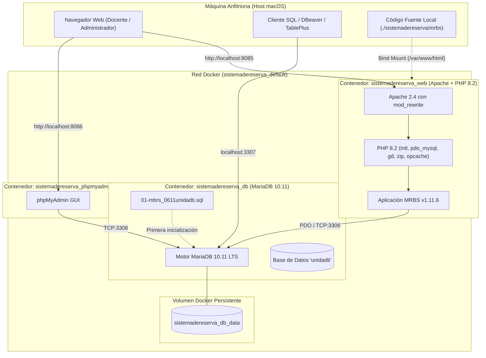
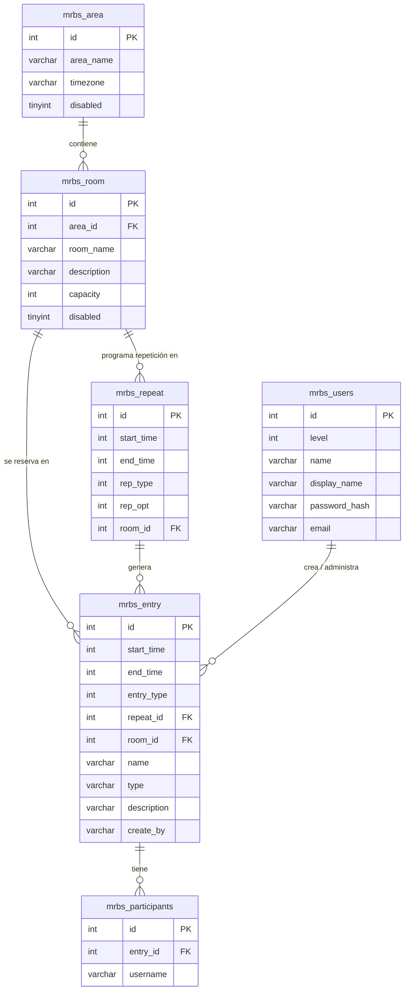

# 🏛️ Documento de Arquitectura y Especificaciones Técnicas (`arquitectura.md`)
## Sistema de Gestión Horaria y Reserva de Espacios Académicos

Este documento detalla la arquitectura de software, infraestructura contenerizada, modelo de datos relacional, contratos de configuración y directrices técnicas del sistema de reservas para trabajo y desarrollo local.

---

## 1. Diagrama de Arquitectura de Infraestructura (Docker)



---

## 2. Stack Tecnológico

| Capa | Tecnología | Versión | Rol / Justificación |
| :--- | :--- | :--- | :--- |
| **Servidor Web** | Apache HTTP Server | `2.4.69` | Soporte `.htaccess`, `mod_rewrite` y compresión `mod_deflate`. |
| **Lenguaje Backend** | PHP | `8.2.35` | Compatibilidad estricta con MRBS 1.11.x, tipado estricto y alto rendimiento. |
| **Extensiones PHP** | `intl`, `pdo_mysql`, `mysqli`, `gd`, `zip`, `opcache` | Oficiales | Necesarias para localización, conexión a BD, generación de códigos QR y renderizado gráfico. |
| **Base de Datos** | MariaDB | `10.11 LTS` | Motor relacional compatible con el volcado SQL legacy, soporte UTF-8 (`utf8mb4_unicode_ci`). |
| **Administración BD** | phpMyAdmin | `Latest` | Interfaz web ligera para inspección, consultas SQL y backups. |
| **Orquestación** | Docker Compose | `v2 / v5` | Entorno reproducible, aislado y configurable con un solo comando. |

---

## 3. Matriz de Puertos, Conectividad y Credenciales

> [!NOTE]
> Estas credenciales están configuradas para el entorno de desarrollo local. Para producción deben utilizarse secretos inyectados por gestor de variables.

| Servicio | Nombre Contenedor | Puerto Host | Puerto Interno | Variables Clave |
| :--- | :--- | :--- | :--- | :--- |
| **MRBS Web** | `sistemadereserva_web` | `8085` | `80` | `DB_HOST=db`<br>`DB_DATABASE=unidadti`<br>`DB_LOGIN=unidadti`<br>`DB_PASSWORD=6gsi26SzTZzmwRQW` |
| **Base de Datos** | `sistemadereserva_db` | `3307` | `3306` | `MYSQL_DATABASE=unidadti`<br>`MYSQL_USER=unidadti`<br>`MYSQL_PASSWORD=6gsi26SzTZzmwRQW`<br>`MYSQL_ROOT_PASSWORD=rootpassword` |
| **phpMyAdmin** | `sistemadereserva_phpmyadmin` | `8086` | `80` | `PMA_HOST=db`<br>`PMA_USER=unidadti`<br>`PMA_PASSWORD=6gsi26SzTZzmwRQW` |

---

## 4. Estructura de Directorios del Proyecto

```text
Reservas de Salas Gestión Horaria/
├── AGENTS.md                   # Catálogo maestro de agentes IA y reglas Safe Vibe Coding
├── history.md                  # Bitácora cronológica de acciones y despliegues
├── problemas.md                # Registro de incidencias técnicas y sus soluciones
├── arquitectura.md             # Especificación técnica del sistema y arquitectura
└── sistemadereserva/           # Carpeta del sistema contenerizado
    ├── .dockerignore           # Exclusiones de construcción de imagen Docker
    ├── Dockerfile              # Definición de la imagen Web (PHP 8.2 + Apache)
    ├── docker-compose.yml      # Manifiesto de orquestación de servicios
    ├── README.md               # Guía rápida de inicio y comandos
    ├── DB/
    │   └── mbrs_0611unidadti.sql  # Volcado de BD inicial (28.572 registros)
    └── mrbs/                   # Código fuente de la aplicación (Bind mount)
        ├── config.inc.php      # Configuración de base de datos, bloques y locale
        ├── systemdefaults.inc.php # Parámetros por defecto del sistema
        ├── areadefaults.inc.php   # Parámetros por área/edificio
        ├── internal/           # Lógica interna y controladores
        ├── lib/                # Bibliotecas del núcleo MRBS y DBFactory
        ├── js/                 # Scripts cliente y componentes interactivos
        └── Themes/             # Plantillas visuales y estilos CSS
```

---

## 5. Modelo de Datos y Entidades Principales

La base de datos relacional `unidadti` contiene las siguientes entidades troncales:



### Volumetría Actual en BD:
- **`mrbs_entry` (Reservas históricas):** 28.572 registros.
- **`mrbs_room` (Salas y Laboratorios):** 53 recintos registrados.
- **`mrbs_area` (Pabellones / Unidades):** 14 áreas institucionales.
- **`mrbs_users` (Usuarios):** 13 cuentas con niveles `1` (Usuario general) y `2` (Administrador).

---

## 6. Lógica de Negocio y Reglas Académicas

### Bloques Horarios (Campus Los Ángeles)
El sistema opera en modo de **períodos pedagógicos personalizados** (`$enable_periods = TRUE`) distribuidos en 13 bloques:
1. `08:15 - 09:00`
2. `09:00 - 09:45`
3. `09:50 - 10:35`
4. `10:35 - 11:20`
5. `11:25 - 12:10`
6. `12:10 - 12:55`
7. `13:00 - 13:45`
8. `13:45 - 14:30`
9. `14:35 - 15:20`
10. `15:20 - 16:05`
11. `16:10 - 16:55`
12. `16:55 - 17:40`
13. `17:45 - 18:30`

### Tipos de Reserva por Carrera / Unidad
Codificados con letras internas:
- **`A`**: General
- **`B`**: Auditoría
- **`C`**: Ingeniería Comercial
- **`D`**: Ingeniería Geomática
- **`F`**: Ingeniería en Biotecnología Vegetal
- **`G`**: Pedagogía en Ciencias Naturales y Biología (PCNB)
- **`H`**: Pedagogía en Matemáticas
- **`J`**: Pedagogía en Inglés
- **`K`**: Pedagogía en Español
- **`L`**: Educación General Básica
- **`M`**: Educación Diferencial
- **`N`**: Enfermería
- **`O`**: CADE
- **`P` - `Y`**: Escuelas y Unidades de Apoyo (Educación, Ciencias, Dirección, Vinculación, Deportes, etc.)

---

## 7. Protocolos de Seguridad y Anti-Doble Reserva (Safe Vibe Coding)

1. **Anti-Doble Reserva en BD:**
   - Toda validación de disponibilidad no puede descansar únicamente en el frontend o en memoria de PHP.
   - En MySQL/MariaDB las reservas se confirman bajo transacción atómica garantizada por los índices de `room_id`, `start_time` y `end_time` en `mrbs_entry`.
2. **Seguridad de Sesiones:**
   - Parámetros `SameSite=Strict`, `HttpOnly` y `Secure` (cuando se use HTTPS).
   - Bloqueo de exposición de trazas con `display_errors = Off` y registro estructurado en `error_log`.
3. **Control de Acceso Basado en Roles (RBAC):**
   - Nivel 0: Consulta pública (si está habilitada).
   - Nivel 1: Docente / Solicitante estándar.
   - Nivel 2: Administrador de Campus / Unidad de TI.
